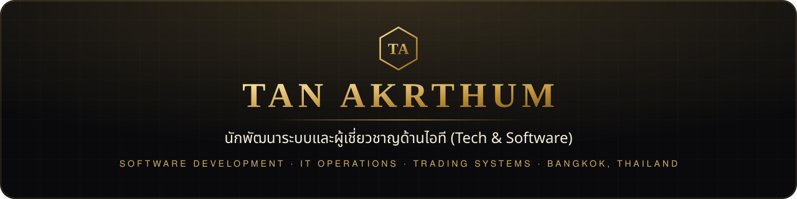

 

  

### 👋 สวัสดีครับ

ทำงานสาย **IT (Tech & Software)** ที่กรุงเทพฯ — ชอบสร้างเครื่องมือที่แก้ปัญหาจริงในที่ทำงาน และระบบที่วัดผลได้ด้วยตัวเลขจริง

### ✦ ผลงานเด่น

<table>
<tr>
<td width="50%" valign="top">

**✦ [Gold Signal](https://github.com/tanakrthum254614-max/gold-signal)** 
เว็บสัญญาณเทรดทองคำ XAU/USD แบบเรียลไทม์ · ทดสอบย้อนหลังหลายปี · เปิดผลจริงทุกไม้ · สมาชิกแบบชำระเงิน (Stripe · PromptPay) · แจ้งเตือน LINE · โค้ช AI

</td>
<td width="50%" valign="top">

**👨‍💻 [Portfolio](https://github.com/tanakrthum254614-max/tan-portfolio)** 
เว็บพอร์ตโฟลิโอส่วนตัว — ประสบการณ์ · ทักษะ · ผลงาน · ใบประกาศ

</td>
</tr>
<tr>
<td valign="top">

**🛠️ [IT Runbook](https://github.com/tanakrthum254614-max/it-runbook)** 
หน้ารวมวิธีแก้ปัญหา IT ให้ user แก้เองก่อนเปิด ticket · สถิติลด ticket

</td>
<td valign="top">

**⏰ [IT Expiry Alert](https://github.com/tanakrthum254614-max/it-expiry-alert)** 
เตือนก่อน SSL · โดเมน · License · สัญญา MA หมดอายุ ผ่าน LINE / Slack / Telegram

</td>
</tr>
<tr>
<td valign="top">

**💻 [IT Asset Tracker](https://github.com/tanakrthum254614-max/it-asset-tracker)** 
ทะเบียนอุปกรณ์ IT แทน Excel · ป้าย QR · ประวัติส่งมอบ · ประกัน · CSV

</td>
<td valign="top">

</td>
</tr>
</table>

### ✦ เครื่องมือที่ใช้

         

Bangkok, Thailand 🇹🇭

